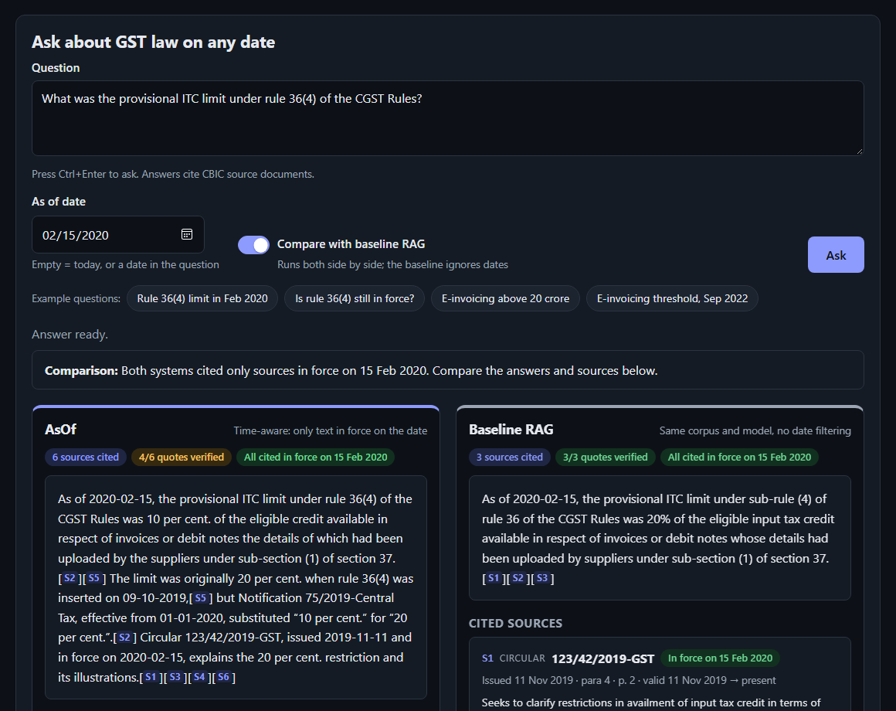
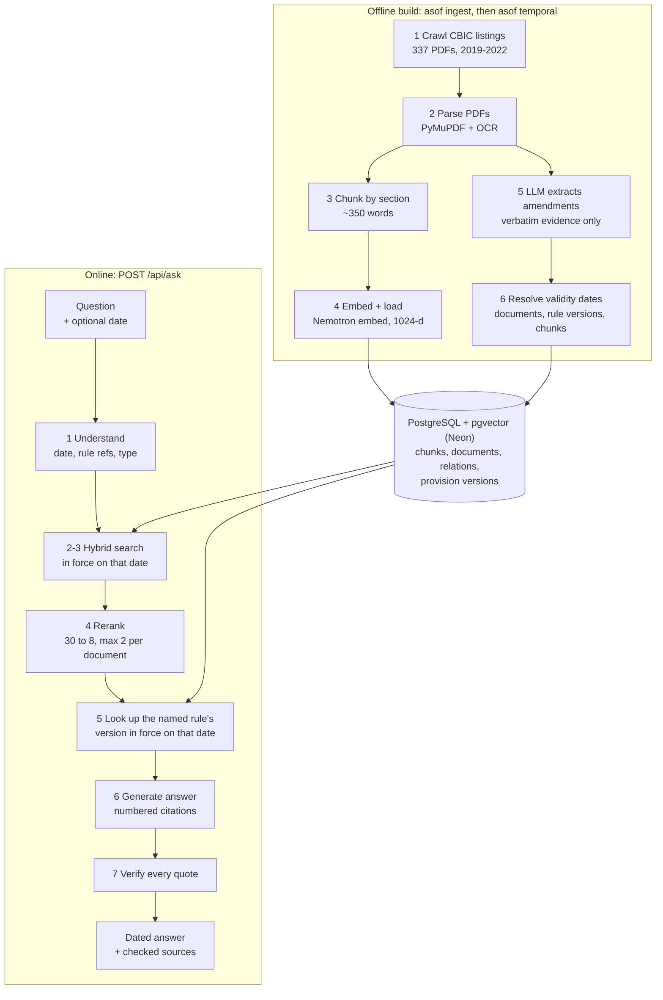
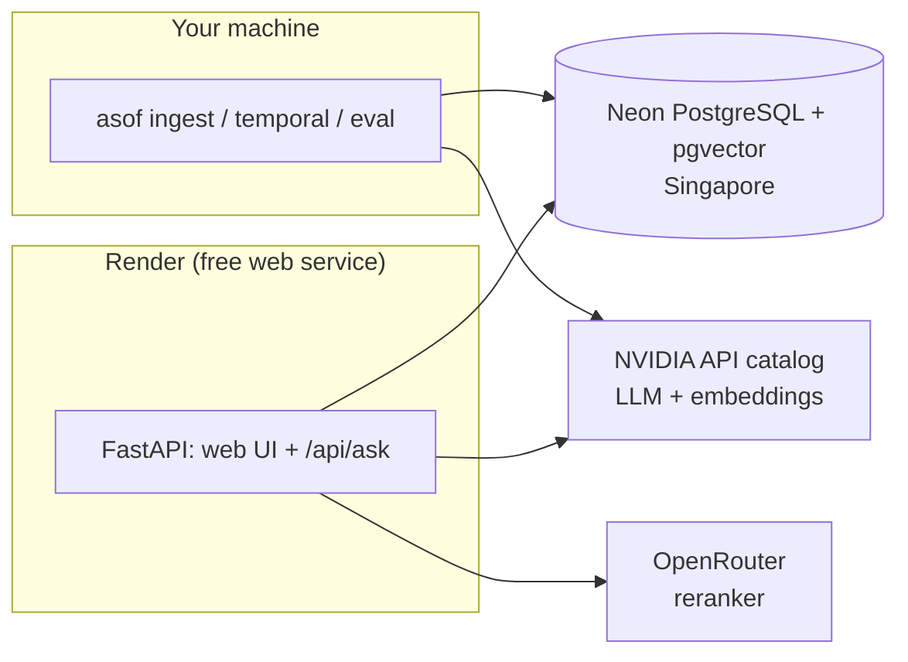

# AsOf: Time-Aware RAG for Indian GST Law

[](https://github.com/Pranav-Conova/-RAG-/actions/workflows/ci.yml)


> **AsOf is an open-source, time-aware retrieval-augmented generation (RAG) system for Indian
> GST law.** It answers *"what was the rule on date X?"* by storing the period each
> notification, circular and provision was in force, following amendment and supersession
> chains, and citing the exact source text.

[](docs/img/compare.png)

*Same question, same corpus, same model. As of 15 Feb 2020, **AsOf** answers "10 per cent" and explains the change
from 20% by Notification 75/2019; the **baseline RAG** answers "20%", which had already been amended. Every quote
is verified against its source and highlighted.*

**Contents:** [Key facts](#key-facts) · [The problem](#the-problem-standard-rag-answers-from-outdated-law) · [Results](#results-asof-vs-a-standard-rag) ·
[How it works](#how-asof-works-architecture) · [Features](#features-and-status) · [Tech stack](#tech-stack) ·
[Quick start](#quick-start) · [Configuration](#configuration) · [Deployment](#deploying-to-render) ·
[Project structure](#project-structure) · [Roadmap](#roadmap) · [FAQ](#faq) ·
[Glossary](#glossary-of-technical-terms) · [Citation](#how-to-cite)

---

## Key facts

| | |
|---|---|
| **What it is** | A time-aware (point-in-time) RAG pipeline: legal question in, dated and cited answer out |
| **Domain** | Indian Goods and Services Tax (GST): CGST Act 2017, CGST Rules 2017, CBIC Central Tax notifications and CBIC circulars |
| **Core idea** | Every chunk of text stores a **validity date range**; retrieval only uses text that was in force on the requested date |
| **Language** | Python 3.11+ |
| **Models** | NVIDIA Nemotron 3.5 (LLM and embeddings, NVIDIA API catalog) and Nemotron 3.5 Rerank 8B (via OpenRouter); all free tier |
| **Storage** | PostgreSQL + pgvector (vector search, full-text search, date ranges and an amendment graph in one database) |
| **Hosting** | FastAPI on Render, database on Neon (both free tier, Singapore region) |
| **Results** | 64% vs 38% answer accuracy and 0% vs 29% stale citations against a standard RAG ([details](#results-asof-vs-a-standard-rag)) |
| **Status** | Working end to end: ingestion, temporal layer, hybrid retrieval, grounded answers, web UI and evaluation harness |
| **Disclaimer** | Portfolio and research project. **Not legal or tax advice.** |

## The problem: standard RAG answers from outdated law

Regulations are **versioned**. A GST rule can be introduced, amended several times, and finally
omitted, and each change arrives as a separate notification. For example, the provisional
input tax credit (ITC) cap in **Rule 36(4) of the CGST Rules** changed several times between
2019 and 2022 before the sub-rule was omitted.

A standard RAG system retrieves whichever passage is most *semantically similar* to the
question. For versioned law that is often an **amended or superseded** version, so the answer
sounds right, cites a real document, and is wrong for the date that matters.

**AsOf makes time a first-class retrieval dimension**:

| Question type | Standard RAG | AsOf |
|---|---|---|
| "What was the ITC cap under Rule 36(4) in February 2020?" | Returns the most similar version, any year | Returns only the version valid on 2020-02-15 |
| "Is circular X still in force?" | Can't tell | Follows the supersession chain |
| "What changed between 2019 and 2022?" | No notion of versions | Lists each version with its validity dates |
| Conflicting sources | Picks one arbitrarily | Applies precedence: statute > rules > notification > circular; later > earlier |
| Unsupported claim | Often answers anyway | Verifies citations and abstains when unsupported |

## How AsOf works (architecture)

AsOf has two halves:

1. **An offline build pipeline** (runs on your machine): downloads the law, splits it into
   passages, works out *which passage was in force when*, and stores everything in PostgreSQL.
2. **An online question pipeline** (the web app / API): turns a question into a dated search,
   retrieves only passages in force on that date, and writes an answer whose every quote is
   checked against the source.



### Part 1: building the knowledge base (offline)

| Step | What happens | Code |
|---|---|---|
| **1. Crawl** | Reads CBIC's listing pages for Central Tax notifications and GST circulars (2019–2022) and downloads each English PDF politely (1 request/second). 164 notification PDFs had moved, so they are fetched from CBIC's tax-information portal instead. | `ingest/crawl.py` |
| **2. Parse** | Extracts text page by page with PyMuPDF. Gazette PDFs are bilingual, so lines that are mostly Hindi are dropped. Scanned PDFs go through OCR (RapidOCR). | `ingest/parse.py` |
| **3. Chunk** | Splits each document into passages of 250–450 words (target 350, 40-word overlap) on paragraph/clause boundaries, never mid-sentence. Each chunk records its main reference (`section_ref`, e.g. `rule 36(4)`) and **every** rule/section it mentions (`refs`). | `ingest/chunk.py`, `temporal/refs.py` |
| **4. Embed + load** | Each chunk is embedded (NVIDIA `nemotron-3.5-embed-1b`, 1024 numbers, "passage" mode, prefixed with the document number, date and subject) and stored in PostgreSQL with a vector index (HNSW) and a full-text index. | `ingest/load.py` |
| **5. Extract amendments** | For every document that mentions amending words (*amend, substitute, insert, omit, rescind, supersede, clarify…*), the LLM lists what it changes, e.g. *"75/2019 **substitutes** wording in rule 36(4), effective 2020-01-01"*. Each relation must quote the document verbatim; relations whose quote is not found in the text are thrown away. Results are cached, so re-runs are free. | `temporal/extract.py`, `temporal/store.py` |
| **6. Resolve validity** | Turns the relations into date ranges (see below) on documents, rule versions and chunks. | `temporal/validity.py` |

**How validity dates are worked out (the core idea).** Every range is half-open
`[valid_from, valid_to)`; an empty end means "still in force".

- **Documents:** in force from their effective (or issue) date until a later document
  rescinds or supersedes them.
- **Rule versions:** all amendments to one rule are put in date order. A version ends only when
  a later amendment replaces *its* wording, replaces or omits the whole rule, or replaces the
  parent rule. Adding or swapping a proviso does **not** end the main wording, so versions can
  overlap (both are law at the same time).
- **Chunks:** a chunk inherits its document's range, or the range of the rule version it describes.

Result for rule 36(4), straight from the database:

| Version (notification) | In force | What it says |
|---|---|---|
| 49/2019-Central Tax | 2019-10-09 → 2020-01-01 | provisional ITC capped at 20 per cent |
| 75/2019-Central Tax | 2020-01-01 → 2021-01-01 | cap reduced to 10 per cent |
| 94/2020-Central Tax | 2021-01-01 → 2022-01-01 | cap reduced to 5 per cent |
| 30/2020, 13/2021, 27/2021 | overlapping, until 2022-01-01 | provisos (cumulative application for certain months) |
| 40/2021-Central Tax | 2022-01-01 → | whole sub-rule replaced (credit only if it appears in GSTR-2B) |

### Part 2: answering a question (online)

| Step | What happens | Code |
|---|---|---|
| **1. Understand** | Finds the **as-of date** (the date picker wins; else a date in the question such as "February 2020" → 2020-02-29; else today), explicit **references** (`rule 36(4)`, `49/2019-Central Tax`, circular numbers) and the **question type** (point-in-time, current, history). Dates after "issued/notified on" are ignored. The LLM writes 1–3 search queries; if it fails, a regex-only plan is used. | `retrieval/understand.py` |
| **2. Embed** | The best search query is embedded in "query" mode. | `providers/embeddings.py` |
| **3. Hybrid search** | **One SQL query** gathers three candidate lists of 50: vector similarity (pgvector cosine), keyword match (PostgreSQL full-text) and chunks matching the question's references (`section_ref`, `refs`, document number). They are merged with **reciprocal rank fusion** (k = 60, plus a small boost for reference matches). The **date filter** keeps only chunks whose validity contains the as-of date and whose document was already issued; history questions skip the validity filter but keep the issue-date rule. Returns the top 30. | `retrieval/search.py` |
| **4. Rerank** | A cross-encoder (`nvidia/nemotron-3.5-rerank-8b` via OpenRouter) rescores the 30 candidates against the question and the best 8 are kept, **at most 2 per document** so one long circular cannot crowd out the notification that actually changed the rule. If OpenRouter fails or its free daily limit is reached, the LLM scores them instead. | `providers/rerank.py`, `pipeline.py` |
| **5. Look up the rule's version** | Search finds passages that *talk about* a rule; this step fetches the text that *set its wording* on the date. For each rule/section named in the question, the version(s) in force on the as-of date are read straight from `provision_versions` (built in Part 1) and placed first, as the verbatim amendment wording with its validity dates (marked "amendment text"). Overlapping versions (main text + later provisos) all come back. History questions get **every** version in date order, plus the chain of notifications that amend the same base notification (e.g. e-invoicing: 13/2020 amended by 88/2020, 5/2021, 1/2022, 17/2022). | `retrieval/provisions.py` |
| **6. Generate** | The LLM (`nvidia/nemotron-3.5-super`) gets the 8 passages (12 for history questions) as numbered sources `[S1]…[S8]`, each with its document number, issue date, validity range and section. It must answer only from them, state the as-of date, cite each claim with `[S#]` plus a short verbatim quote, mention later amendments, or abstain if the sources do not answer. When several amendments to one rule are in force, it is told that each changes only the part it names and that the later one wins where they change the same words. Output is JSON; malformed JSON is repaired and cut-off output is retried with a bigger budget. | `generation/answer.py` |
| **7. Verify quotes** | Every quote is checked against its source: an exact match on word boundaries after normalising case, spacing and quote marks, or a fuzzy match (≥ 85 %, quotes of 20+ characters) in which **all numbers must line up in order** and no negation (*not, except, omitted…*) may differ. Unverified quotes are flagged in the API and UI. | `generation/answer.py` |
| **8. Return** | `AskResult`: the interpreted plan, the sources with validity ranges, the answer, each citation with `verified: true/false`, and per-step timings. | `pipeline.py`, `api/main.py` |

**The baseline ("standard RAG") used for comparison** uses the same corpus, embeddings, LLM and
answer prompt, but: no query understanding, vector search only (top 8), **no date filter**, no
reranking and no rule-version lookup. Switch to it with `mode: "baseline"` or the *Compare* toggle in the UI.

The date filter at the heart of it (simplified from `retrieval/search.py`):

```sql
SELECT c.text, d.number, lower(c.validity) AS valid_from, upper(c.validity) AS valid_to
FROM chunks c JOIN documents d ON d.id = c.doc_id
WHERE c.validity @> DATE '2020-02-15'              -- in force on the as-of date
  AND d.issue_date <= DATE '2020-02-15'            -- and already issued
ORDER BY c.embedding <=> :query_vector             -- cosine distance (pgvector)
LIMIT 50;                                          -- (+ full-text and reference lists, fused)
```

### Data model

| Table | One row per | Key columns |
|---|---|---|
| `documents` | notification / circular | number, issue date, subject, URL, status (in force / rescinded / superseded), `validity` |
| `chunks` | passage | text, `embedding halfvec(1024)` (HNSW), `tsv` (full-text, GIN), `section_ref`, `refs[]`, `validity` (GiST) |
| `relations` | extracted amendment | source document, target document or rule, kind, effective date, evidence quote |
| `provisions` | rule or section (e.g. `rule 36(4)`) | instrument, reference |
| `provision_versions` | version of a rule | text, `validity`, source document |
| `index_meta` | setting | embedding model and size the index was built with (prevents mixing) |

### Where each part runs



Heavy work (PDF parsing, OCR, bulk embedding, LLM extraction) runs once on your machine; the
Render service only answers questions, so it fits in 512 MB. All models are free-tier hosted APIs.

### Design decisions, briefly

- **Dates are enforced in SQL, not left to the LLM.** If outdated text reaches the model, it
  often mixes versions. Filtering by validity before generation is what takes the stale-source
  rate from 28.6 % (baseline) to 0 %.
- **One database for everything.** Vector search, keyword search, date ranges and the amendment
  relations live in PostgreSQL, so a single query can ask "relevant **and** in force on this date".
- **Nothing is trusted without a quote.** Extracted amendments must quote their document and
  answer citations must quote their source; both are verified in code.
- **Conservative when unsure.** Overlapping rule versions stay in force together rather than
  risk dropping the passage that answers the question, and the answer model is told to abstain
  when the sources do not support an answer.

## Results: AsOf vs a standard RAG

Same corpus (337 CBIC notifications and circulars, 2019–2022), same LLM, same embeddings. The
**baseline** is a standard RAG: vector search only, no dates, no reranking. **AsOf** adds query
understanding, date-filtered hybrid search, reranking and quote verification.
49 questions ([`eval/benchmark.jsonl`](eval/benchmark.jsonl)); full report in
[`eval/results/summary.md`](eval/results/summary.md).

| Metric | AsOf | Baseline |
|---|---|---|
| **Answer accuracy** (key facts present, no outdated facts) | **64.1%** (25/39) | 38.5% (15/39) |
| Correct document ranked first (recall@1) | **59.0%** | 20.5% |
| Correct document in top 5 (recall@5) | **79.5%** | 46.2% |
| At least one verified citation to the correct document | **76.9%** | 41.0% |
| **Stale-source rate** (cites a document not in force on the date) — lower is better | **0.0%** (0/39) | 28.6% (10/35) |
| Correctly answered vs declined (abstention accuracy) | **89.8%** | 69.4% |
| Median latency | 8.3 s | 3.2 s |

**What this shows:** for date-sensitive legal questions, a standard RAG cites law that was not
in force on the date asked in more than a quarter of answers; AsOf's validity filter removes that
failure entirely, and retrieval of the right document nearly triples at rank 1.

**Honest caveats**
- Small set (49 questions); differences of a few points are noise.
- 20 questions were hand-written and checked against the source text; 29 were generated from the
  provision version chains that AsOf's own temporal layer extracted (key facts verified verbatim,
  ambiguous ones dropped). That second group may favour AsOf; a larger, independently written
  set is the next step.
- Accuracy is strict text matching of key facts, so correct answers phrased differently can count
  as wrong (the true accuracy of both systems is likely higher).
- AsOf is slower (query understanding + reranking); latency includes free-tier rate limiting.
- These numbers come from commit `35f16f5`. A later code review fixed 10 defects (stricter quote
  verification and reference matching, history questions, date parsing). A re-run on the fixed
  code was cut short by the NVIDIA free-tier rate limit: AsOf completed 48/49 questions with 59.0%
  answer accuracy, 48.7% recall@1 and 2.6% stale-source rate (1/38, a history question), but the
  baseline and ablations did not finish
  ([partial summary](eval/results/postfix-partial/summary.md)). A full re-run is pending.

## Features and status

| Feature | Status |
|---|---|
| PostgreSQL schema with date-range validity, amendment relations, HNSW and full-text indexes | ✅ Done |
| NVIDIA LLM + embedding providers with rate limiting, retries and structured (JSON) output | ✅ Done |
| OpenRouter reranker with automatic LLM-based fallback | ✅ Done |
| `asof smoke` live check of every model, `asof db-init` schema setup | ✅ Done |
| FastAPI service with health checks, SEO landing page, `robots.txt`, `sitemap.xml`, `llms.txt` | ✅ Done |
| CBIC crawler (notifications + circulars, 2019–2022), PDF parsing, OCR fallback, section-aware chunking, embedding loader | ✅ Done |
| Baseline (date-unaware, vector-only) RAG as a control group | ✅ Done |
| LLM extraction of amendment relations (amends / substitutes / inserts / omits / rescinds / supersedes / clarifies) with verbatim-evidence checks | ✅ Done |
| Validity resolution: document rescission/supersession and provision-level version chains | ✅ Done |
| Query understanding (as-of date, references, question type), hybrid search (vector + full-text + reference boost, RRF), date filter, reranking | ✅ Done |
| Grounded answers with numbered citations, quote verification and abstention | ✅ Done |
| `POST /api/ask` and a web UI with as-of date picker and side-by-side AsOf vs baseline comparison | ✅ Done |
| Evaluation harness (correctness, recall@k, citation precision, stale-source rate, abstention, latency) | ✅ Done |
| Larger evaluation set (~150 questions) and published ablations | 🚧 Next |
| Conflict detection between sources, provision timeline view | 🚧 Next |

## Tech stack

| Layer | Technology | Why |
|---|---|---|
| Language | Python 3.11+ | Ecosystem for AI, parsing and data work |
| LLM | `nvidia/nemotron-3.5-super-vl-120b-a12b` via the NVIDIA API catalog | Free, about 1 s per call, OpenAI-compatible API |
| Embeddings | `nvidia/nemotron-3.5-embed-1b`, 1024 dimensions | Free, multilingual, asymmetric query/passage modes |
| Reranker | `nvidia/nemotron-3.5-rerank-8b:free` via OpenRouter, LLM fallback | Free cross-encoder with a graceful fallback |
| Database | PostgreSQL + pgvector (`halfvec`), hosted on Neon | Vectors, full-text search, date ranges and graph in one SQL query |
| API | FastAPI + Uvicorn | Typed, async-ready, automatic OpenAPI docs |
| Validation | Pydantic v2, pydantic-settings | Typed config and LLM output validation |
| HTTP | httpx, OpenAI Python SDK, tenacity | Clients and retries with backoff |
| Parsing (planned) | PyMuPDF, Docling, RapidOCR | PDFs, tables and scanned documents |
| CI | GitHub Actions with a pgvector service container | Lint and run all tests on every push |
| Hosting | Render (API), Neon (database) | Free tiers, same region (Singapore) |

## Quick start

```bash
# 1. Install (Python 3.11+)
git clone https://github.com/Pranav-Conova/-RAG-.git asof && cd asof
python -m venv .venv
source .venv/bin/activate          # Windows: .venv\Scripts\activate
pip install -e ".[dev]"            # add ,ingest for PDF parsing (Phase 1)

# 2. Configure: copy the template and add your keys
cp .env.example .env               # NVIDIA key: build.nvidia.com, OpenRouter key: openrouter.ai

# 3. Create the database schema (Neon connection string in .env, or: docker compose up -d)
asof db-init

# 4. Check every model responds
asof smoke

# 5. Build the corpus (resumable; downloads ~340 CBIC PDFs, embeds and loads them)
pip install -e ".[ingest]"
asof ingest --years 2019-2022
asof temporal                      # extract amendment relations + resolve validity dates

# 6. Ask questions
asof ask "What was the provisional ITC limit under rule 36(4) in February 2020?"
asof ask "..." --mode baseline     # the naive RAG, for comparison

# 7. Run the web app, the evaluation and the tests
uvicorn asof.api.main:app --reload   # web UI at http://localhost:8000, API docs at /docs
asof eval --systems asof,baseline    # writes eval/results/summary.md
pytest
```

## Configuration

All settings are environment variables (or `.env`). See [`.env.example`](.env.example).

| Variable | Default | Purpose |
|---|---|---|
| `NVIDIA_API_KEY` | none | NVIDIA API catalog key (`nvapi-…`) |
| `LLM_MODEL` / `LLM_FAST_MODEL` | `nvidia/nemotron-3.5-super-vl-120b-a12b` | Answer model / model for extraction, query understanding, verification |
| `EMBED_MODEL` / `EMBED_DIM` | `nvidia/nemotron-3.5-embed-1b` / `1024` | Embedding model and vector size (must match the database) |
| `RERANK_BACKEND` | `llm` (`openrouter` recommended) | `openrouter`, `llm`, `nim` or `none` |
| `OPENROUTER_API_KEY` | none | OpenRouter key (`sk-or-…`) for reranking |
| `OPENROUTER_RERANK_MODEL` | `nvidia/nemotron-3.5-rerank-8b:free` | Reranker model on OpenRouter |
| `NIM_REQUESTS_PER_MINUTE` | `35` | Client-side rate limit for NVIDIA (free tier is about 40/min) |
| `DATABASE_URL` | local Docker Postgres | PostgreSQL connection string (Neon pooled URL in production) |
| `PUBLIC_BASE_URL` | derived from request | Public site URL for canonical links, sitemap and `llms.txt` |

## Deploying to Render

1. Create a free **Neon** project in **AWS Asia Pacific (Singapore)** (1 GB storage, scales to
   zero when idle). Put its **pooled** connection string in `.env` as `DATABASE_URL` and run
   `asof db-init`; this also enables the `vector` extension.
2. In Render choose **New → Blueprint** and select this repository. [`render.yaml`](render.yaml)
   deploys the API in the Singapore region. Set `NVIDIA_API_KEY`, `OPENROUTER_API_KEY`,
   `DATABASE_URL` and optionally `PUBLIC_BASE_URL`.
3. Run ingestion from your own machine with `DATABASE_URL` pointing at Neon
   (`asof ingest`, then `asof temporal`). Heavy parsing and OCR never run on Render.
   CBIC moved many 2019–2020 notification PDFs; ingestion downloads them from CBIC's
   tax-information portal instead, and `python scripts/fix_dead_links.py` points the UI's
   source links at the portal for those documents.

**Free-tier limits:** NVIDIA API catalog about 40 requests/min (varies by model); OpenRouter
free models 20 requests/min and 50 requests/day (1,000/day after a one-time $10 credit
purchase); Render free instances sleep when idle, so the first request takes about a minute.

## Project structure

```
src/asof/
  config.py                settings from environment / .env
  models.py                shared data contracts (DocMeta, Hit, QueryPlan, Answer, AskResult, ...)
  cli.py                   asof db-init | smoke | ingest | temporal | ask | eval | eval-generate
  db/schema.sql            tables, date ranges, vector + full-text + GiST + GIN indexes
  ingest/                  CBIC crawler (+ portal fallback), PDF parsing/OCR, chunking, loader
  temporal/                relation extraction, reference normalisation, validity resolution
  retrieval/               query understanding (dates, references), hybrid date-filtered search
  generation/              grounded answers with numbered citations and quote verification
  pipeline.py              ask(question, as_of, mode="asof" | "baseline")
  providers/               NVIDIA LLM + embeddings, rerankers (OpenRouter / LLM), rate limiter
  evaluation/              question format, metrics, runner, grounded question generator
  api/                     FastAPI app, landing page + web UI (static/), crawler files
scripts/make_temporal_questions.py   point-in-time questions from provision version chains
eval/                      benchmark questions, README, results/summary.md
tests/                     unit tests (mocked HTTP) + database tests (pgvector)
PLAN.md                    architecture, data model and phased build plan
```

## Roadmap

| Phase | Scope | Status |
|---|---|---|
| 0 | Setup: schema, model providers, CLI, API, CI | ✅ |
| 1 | Corpus ingestion and a date-unaware baseline RAG | ✅ |
| 2 | Evaluation harness and seed question set (point-in-time, current, history, supersession-trap, unanswerable) | ✅ (set growing) |
| 3 | Temporal layer: amendment graph, validity resolution, as-of retrieval | ✅ |
| 4 | Retrieval upgrades: hybrid search, query understanding, reranking | ✅ (ablations next) |
| 5 | Grounded generation, citation verification, abstention | ✅ |
| 6 | Conflict detection between sources | 🚧 |
| 7 | Web UI ✅, deployment and published results | 🚧 |

Details are in [PLAN.md](PLAN.md).

## FAQ

### What is AsOf?
AsOf is an open-source, time-aware retrieval-augmented generation (RAG) system for Indian GST
law. It answers questions as of a specific date, using only the notifications, circulars and
provisions that were in force on that date, and cites the exact source text.

### What is time-aware (temporal) RAG?
Time-aware RAG adds a date dimension to retrieval. Every piece of text stores the period it was
valid for, and a question is answered only from text that was in force on the requested date,
instead of from whichever text sounds most similar.

### How is AsOf different from a standard RAG chatbot?
A standard RAG chatbot retrieves the most semantically similar passage, which for versioned law
is often an amended or superseded rule. AsOf filters by validity dates, follows amendment and
supersession chains, resolves conflicts by legal precedence, and verifies that every cited
quote appears in its source.

### Which documents does AsOf cover?
The planned corpus is the CGST Act 2017, the CGST Rules 2017, CBIC Central Tax notifications and
CBIC GST circulars from 2017 onwards. State GST variations and case law are out of scope for
version 1.

### Which AI models does AsOf use?
NVIDIA Nemotron 3.5 Super for generation, NVIDIA Nemotron 3.5 Embed 1B for 1024-dimensional
embeddings, and NVIDIA Nemotron 3.5 Rerank 8B (via OpenRouter) for reranking. All models are
configurable, and `asof smoke` checks that the configured models are still available.

### Is AsOf free to run?
Yes. It runs entirely on free tiers: the NVIDIA API catalog, OpenRouter free models, Neon
PostgreSQL and Render. Free tiers are rate limited and intended for development and demos.

### Why PostgreSQL and pgvector instead of a dedicated vector database?
AsOf needs vector similarity, keyword search, date-range filtering and graph traversal in the
same query. PostgreSQL with pgvector does all four, so a single SQL query can return text that
is both relevant and valid on the requested date.

### How will accuracy be measured?
With a benchmark of dated questions (currently 49: point-in-time, current-law, history,
"supersession trap" and unanswerable questions), scored for answer accuracy, retrieval recall,
citation correctness, stale-source rate and abstention, against a date-unaware baseline RAG.
Current numbers are in [Results](#results-asof-vs-a-standard-rag): 64% vs 38% answer accuracy
and 0% vs 29% stale-source rate.

### Can the approach be used for other regulations?
Yes. The design applies to any versioned rulebook, such as RBI master directions, SEBI
circulars, insurance policy wordings, medical guidelines or technical standards. Only the
crawler and relation extraction prompts are domain-specific.

### Is AsOf legal or tax advice?
No. AsOf is a portfolio and research project. Always confirm answers against the official CBIC
documents or with a qualified professional.

## Glossary of technical terms

**AI and retrieval**

- **Abstention**: the system declining to answer when its sources do not support an answer, instead of guessing.
- **Ablation**: turning one component off (for example reranking) to measure how much it contributes.
- **Answer engine optimization (AEO)**: structuring content as direct questions and answers so search and answer engines can quote it.
- **As-of date (point-in-time query)**: the date a question refers to; only text valid on that date may be used.
- **Asymmetric embeddings**: embedding models that encode questions (`query`) and documents (`passage`) differently for better retrieval.
- **Chunking**: splitting documents into smaller passages for indexing; AsOf splits on section and rule boundaries.
- **Citation verification**: checking that each quoted passage in an answer actually appears in the cited source.
- **Cosine similarity / distance**: a measure of how similar two embedding vectors are; pgvector's `<=>` operator returns cosine distance.
- **Cross-encoder**: a model that reads a question and a passage together and scores their relevance; more accurate than embeddings alone, used for reranking.
- **Embedding**: a list of numbers (a vector) representing the meaning of a text, so similar texts have nearby vectors.
- **Evaluation set (eval)**: a fixed set of questions with known answers and sources, used to measure accuracy objectively.
- **Fallback**: a backup component used automatically when the primary one fails, such as the LLM reranker when OpenRouter is unavailable.
- **Generative engine optimization (GEO)**: making content easy for AI systems (ChatGPT, Claude, Perplexity, Google AI Overviews) to understand and cite accurately.
- **Grounding / grounded generation**: generating answers only from retrieved sources, not from the model's memory.
- **Hallucination**: a fluent but false or unsupported statement produced by a language model.
- **Hybrid search**: combining vector (semantic) search with keyword (full-text) search.
- **Large language model (LLM)**: a neural network trained on text that generates and reasons over language.
- **Logit**: a model's raw, unnormalized score; for rerankers, higher means more relevant.
- **Matryoshka embeddings**: embeddings that can be shortened (for example 2048 to 1024 dimensions) with little quality loss.
- **Query understanding**: extracting structure from a question, such as its date, type and referenced rules.
- **Rate limiting**: capping requests per minute to stay within a provider's limits.
- **Reciprocal rank fusion (RRF)**: merging several ranked result lists by summing `1 / (k + rank)` for each item.
- **Reranking**: re-ordering retrieved candidates with a more accurate (slower) model before generation.
- **Retrieval-augmented generation (RAG)**: answering questions by first retrieving relevant documents, then having an LLM generate an answer from them.
- **Structured output**: making an LLM return JSON that matches a schema, validated in code (here with Pydantic).
- **Temporal / time-aware RAG**: RAG in which every source has a validity period and retrieval is filtered by date.

**Legal and GST**

- **Amendment**: a change to an existing provision (by substitution, insertion or omission).
- **Amendment graph**: a graph whose edges record which document amends, supersedes or clarifies which provision or document, and from when.
- **CBIC**: Central Board of Indirect Taxes and Customs, which administers GST in India and issues notifications and circulars.
- **CGST / SGST / IGST**: Central, State and Integrated Goods and Services Tax.
- **Circular**: a CBIC clarification of how the law should be applied.
- **Input tax credit (ITC)**: tax paid on purchases that a business can offset against tax on its sales.
- **Notification**: a legally binding instrument that brings provisions into force, amends rules or changes rates.
- **Omission**: removal of a provision, after which it has no text in force.
- **Precedence**: the order used to resolve conflicts: statute > rules > notification > circular; later > earlier; specific > general.
- **Provision**: a citable unit of law, such as "Section 16(4)" or "Rule 36(4)".
- **Rescission**: cancellation of a notification.
- **Supersession**: replacement of an earlier document by a newer one.
- **Validity interval**: the half-open date range `[valid_from, valid_to)` in which a text was in force.

**Databases and infrastructure**

- **Connection pooler**: a service that shares database connections between clients (Neon's pooled endpoint).
- **daterange**: a PostgreSQL type holding a date interval; `validity @> date` tests whether a date falls inside it.
- **FastAPI**: a Python web framework for typed APIs with automatic OpenAPI documentation.
- **GiST index**: a PostgreSQL index type that makes range queries such as date containment fast.
- **halfvec**: pgvector's 16-bit vector type; it halves storage compared with 32-bit vectors.
- **HNSW (Hierarchical Navigable Small World)**: an approximate nearest-neighbour index that makes vector search fast.
- **JSON-LD / schema.org**: structured data embedded in web pages so search engines understand the content (used on the landing page).
- **llms.txt**: a plain-text file that summarizes a project for AI assistants and crawlers.
- **Neon**: serverless PostgreSQL hosting with a free tier and scale-to-zero.
- **NVIDIA API catalog (NIM)**: NVIDIA's hosted model APIs at build.nvidia.com, with an OpenAI-compatible interface.
- **OCR (optical character recognition)**: extracting text from scanned documents.
- **OpenRouter**: a single API that routes requests to many model providers, including free models.
- **pgvector**: a PostgreSQL extension that adds vector types, distance operators and vector indexes.
- **Render**: a cloud platform that deploys web services from a Git repository using a `render.yaml` blueprint.
- **Row-level security (RLS)**: PostgreSQL access control applied per row; enabled here to block unintended public APIs.
- **Scale to zero**: a database or service that stops when idle and starts on the next request.
- **tsvector / full-text search**: PostgreSQL's keyword index for matching words in documents.

## How to cite

If you reference this project, use the metadata in [`CITATION.cff`](CITATION.cff) (GitHub shows a
**"Cite this repository"** button), or:

```bibtex
@software{asof_time_aware_rag,
  title  = {AsOf: Time-Aware RAG for Indian GST Law},
  author = {Pranav-Conova},
  year   = {2026},
  url    = {https://github.com/Pranav-Conova/-RAG-},
  note   = {Open-source time-aware retrieval-augmented generation for versioned regulations}
}
```

## Disclaimer

AsOf is a portfolio and research project. It is not legal or tax advice, and its answers may be
incomplete or out of date. Always check the official [CBIC](https://cbic-gst.gov.in/) source
documents or consult a qualified professional.
